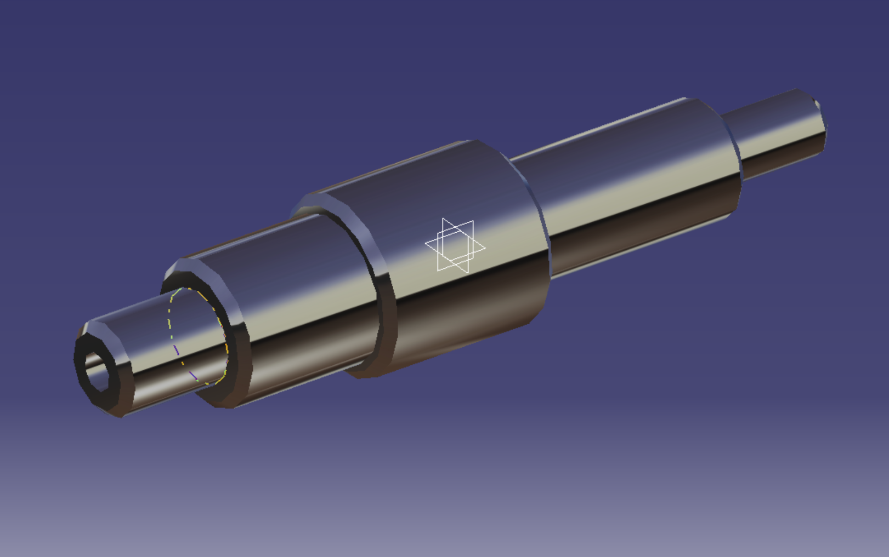
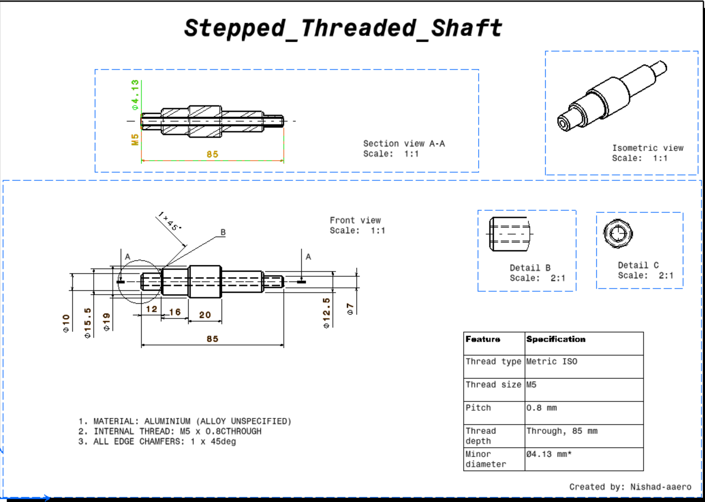

# Project 01: Parametric Design and Manufacturing Detailing of a Five-Step Aluminum Shaft

## 1. Project Overview

This project involves the 3D modelling and engineering drawing preparation of a five-step cylindrical shaft using CATIA V5.

The objective was to develop a dimensionally defined mechanical component and produce a manufacturing-oriented technical drawing with sectional views, dimensional annotations, chamfers, and internal thread specifications.

## 2. Design Specifications

| Parameter | Specification |
|---|---|
| Material | Aluminum (alloy unspecified) |
| Overall length | 85 mm |
| Number of stepped sections | 5 |
| Internal thread | M5 × 0.8 |
| Thread configuration | Through-thread |
| Edge chamfers | 1 mm × 45° |
| CAD software | CATIA V5 |

## 3. Shaft Geometry

| Section | Diameter | Length |
|---|---|---|
| 1 | 10 mm | 12 mm |
| 2 | 15.5 mm | 16 mm |
| 3 | 19 mm | 20 mm |
| 4 | 12.5 mm | 25 mm |
| 5 | 7 mm | 12 mm |

## 4. Work Completed

- Created the five-step shaft model in CATIA V5.
- Applied consistent edge chamfers.
- Defined an M5 × 0.8 internal through-thread.
- Generated front, sectional, and isometric drawing views.
- Added dimensional annotations and manufacturing notes.
- Prepared a technical drawing for manufacturing reference.

## 5. Project Images

### 3D CAD Model

### Engineering Drawing

## 6. Software and Skills

- CATIA V5 Part Design
- CATIA V5 Drafting
- 3D Mechanical Modelling
- Engineering Drawing and Dimensioning
- Manufacturing Detailing

## 7. Future Improvements

- Perform dimensional and tolerance analysis.
- Verify thread and material specifications.
- Conduct structural analysis using ANSYS.
- Evaluate manufacturing feasibility and machining requirements.
